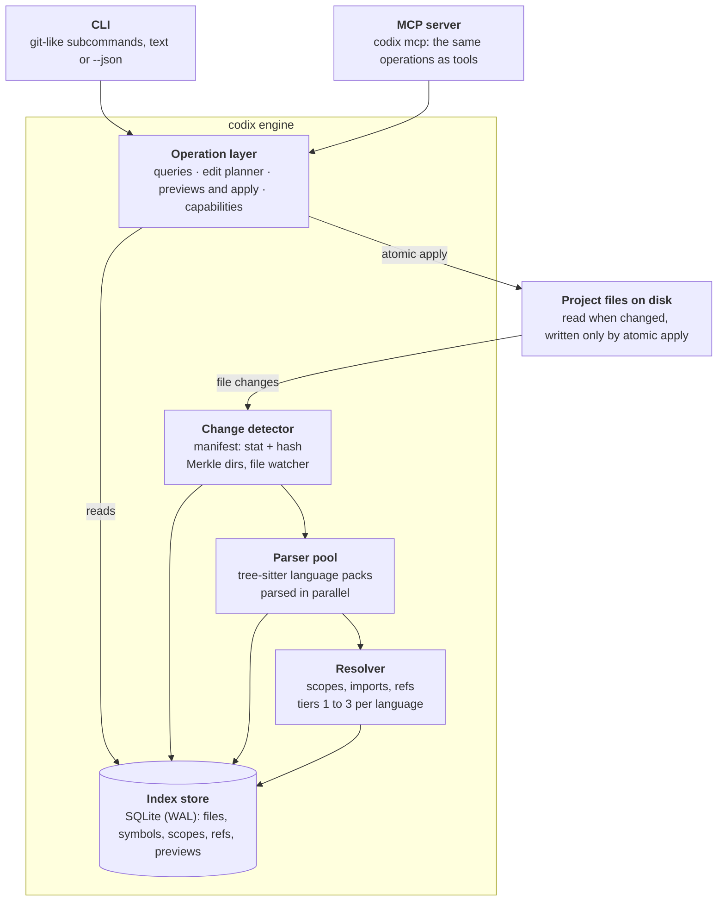

# codix — Design Document

Nov 4, 2026 · @Olivier

## Overview

codix is a standalone, headless code index that gives LLM agents IDE-grade navigation and safe refactoring without an IDE. It indexes many languages, stays current incrementally as files change, and exposes the same operations through a CLI and an MCP server.

Agents today mostly find code with grep and by reading whole files. That wastes context, confuses definitions with mentions, and makes renames unsafe. codix answers structural questions directly (where is this defined, who calls it, what implements it) and turns renames into reviewable edit plans.

**Goals**

- Fast, incremental indexing of large repositories, with or without version control.
- Broad language coverage, with honest per-language capability tiers.
- Symbol-aware queries: definitions, references, outlines, hierarchies, search.
- Safe edits: rename, add and safe delete always applied from a reviewed preview.
- Usable cold by an LLM that has never seen the tool, from its descriptions and outputs alone.
- A single static binary, quick to install anywhere, including sandboxes and CI.

**Non-goals (for now)**

- Integration with IDEs, language servers run by other tools, or external indexes.
- Type checking, compilation, or diagnostics beyond parse errors.
- Arbitrary refactorings (extract method, move class). Rename, add and safe delete come first.
- A GUI. Humans use the CLI; agents use the CLI or MCP.

## Architecture

codix is one engine with two thin frontends. All logic lives in the engine's operation layer, so the CLI and MCP server can never behave differently.



The change detector, parser pool and resolver keep the index current; the operation layer answers from the index and writes files only through atomic apply.

**Process model.** A per-project daemon holds the index open, runs the watcher, and serves requests over a local socket. Without a daemon, each CLI call runs the engine in-process against the same database. Several readers can query while one writer indexes.

**Many projects at once.** Daemons and MCP servers for different projects run side by side and never share state. Each project has at most one daemon, identified by its canonical root path.

- **One daemon per project.** Starting a second daemon for the same project fails and names the running one; `.codix/daemon.lock` enforces this. A daemon for project A never touches project B's index.
- **Per-project sockets.** The socket is `.codix/daemon.sock` on Unix. When that path exceeds the Unix socket length limit (about 104 characters), it moves to the user runtime directory, named by a hash of the canonical root. On Windows it is a named pipe, `\\.\pipe\codix-<root hash>`.
- **Handshake.** `.codix/daemon.json` records the daemon's root, socket, process ID and codix version. A client connecting checks that the daemon serves the same root and a compatible version; after an upgrade, a stale daemon is replaced.
- **Nested projects and worktrees.** Each root found by discovery gets its own daemon, so nested projects and separate git worktrees of one repository are independent.
- **Shared OS limits.** All daemons of one user draw on the same file-watch quota, such as `fs.inotify.max_user_watches` on Linux. When a daemon cannot watch every directory, it falls back to periodic scans for the rest and says so in `status`.
- **Visibility.** Each daemon registers in the user runtime directory, so `codix daemon list` shows every running daemon with its project, memory use and idle time, and `codix daemon stop --all` stops them.

**Implementation stack.** Rust, built as a single static binary.

| Concern | Crate |
| --- | --- |
| Parsing | `tree-sitter` + bundled grammars |
| Directory walking, ignore rules | `ignore` |
| File watching | `notify` |
| Content hashing | `blake3` |
| Parallelism | `rayon` |
| Storage | `rusqlite` (bundled SQLite, FTS5) |
| CLI | `clap` |
| Config editing | `toml_edit` (preserves comments and formatting) |
| Serialization | `serde`, `serde_json` |

The code is a Cargo workspace: a core crate (engine, index, operation layer), the CLI and MCP frontends, and one crate per provider, selected with Cargo features as described under Providers.

## Change detection and incremental indexing

codix reuses git's index mechanism without depending on git: a manifest of file stats and content hashes, checked cheaply first and rehashed only on change. Any directory can be indexed, under version control or not.

**Manifest.** One row per file: path, size, mtime (nanoseconds), inode, content hash (BLAKE3), detected language, parser version, and index status. Directories get a Merkle hash over their children so an unchanged subtree is skipped in one comparison.

**Scan algorithm.**

1. Walk the tree in parallel, honoring ignore rules.
2. For each file, compare stat fields with the manifest. Equal → unchanged, no read.
3. Stat differs → read and hash. Hash equal → update stats only (a touch, not a change).
4. Hash differs or file is new → queue for reparse.
5. Manifest rows with no file on disk → deleted; remove their symbols.
6. Reparse queued files in parallel, then commit all changes in one database transaction.

**Racy timestamps.** As in git, a file modified within the same mtime granularity as the last scan is treated as possibly dirty and rehashed on the next scan.

**Ignore rules.** codix reads `.codixignore` at the project root, with gitignore syntax. It also honors the ignore files named by matching version control providers (`.gitignore` for git), since they usually exclude build output, but never requires them. Defaults exclude `.codix/` and common heavy directories (`node_modules`, `target`, `.venv`, `dist`). Files over a size limit (default 2 MB) and binary files are skipped. Minified files, recognized by their average line length, are indexed for search only, even under the size limit.

**Watch mode.** When the daemon runs, a file watcher (inotify, FSEvents, ReadDirectoryChangesW) feeds changed paths into the same pipeline, debounced by about 100 ms. Watchers can drop events, so the daemon also runs a full stat scan on startup and periodically (default every 10 minutes), which is cheap when little changed.

**Cross-file invalidation.** Definitions are stored per file, so they update when their file updates. A reference stores its name, its context and, once resolved, the target symbol ID. References are resolved at index time. A reverse dependency map marks dependents stale when a file they import changes, and the same reindex resolves them again.

**Self-writes.** Edits that codix applies update the manifest and index directly, so the watcher recognizes the resulting events as known and does not reparse twice.

## Language support

codix covers many languages through bundled tree-sitter grammars and states, per language, how deep that support goes. Each language declares a tier, and operations check the tier before they run.

| Tier | Capabilities | Built from | Rename safety |
| --- | --- | --- | --- |
| 1 — Symbols | Definitions, outlines, name search, textual references | Tree-sitter `tags` queries | Refused; preview of textual matches only with `--textual` |
| 2 — Scopes | Tier 1 + scope-aware references and renames within a file | Tree-sitter `locals` queries | Safe within a file; cross-file marked unresolved |
| 3 — Resolved | Tier 2 + cross-file references, hierarchies, renames | Per-language resolver (imports, modules, types) | Safe; ambiguous sites flagged in the preview |

**Grammars.** Grammars are compiled into the binary, versioned and pinned. A grammar update is a codix release, and the manifest's parser version field forces a reparse of affected files.

**Language packs.** Each language is a pack: grammar, `tags` and `locals` queries, file detection rules, and for tier 3 a resolver module. The initial languages and resolver order are below.

**Initial language plan.** Every launch language starts at tier 1. Java and Go get the first tier 3 resolvers because static types, explicit imports and simple module systems make them the cheapest to resolve correctly; two different languages also prove the resolver framework is generic.

| Language | Target tier | Order | Notes |
| --- | --- | --- | --- |
| Java | 3 | First | Static types, explicit imports, packages map to directories |
| Go | 3 | First | Simplest module system of the set |
| TypeScript | 3 | Next | Module resolution involves `tsconfig` paths, aliases and re-exports |
| Python | 3 | Later | Dynamic attribute access leaves some references only partly resolvable |
| Kotlin | 3 | Later | Needed for mixed Java and Kotlin codebases |
| JavaScript, Rust, C, C++, C#, PHP, Ruby | 2 | With tier 2 rollout | Tier 3 driven by usage |
| JSON, YAML, TOML, XML, Markdown, SQL | Search only | Launch | Keys and headings indexed for search |

**Java specifics.** The Java resolver handles overload resolution by argument types, overrides across classes and interfaces (renaming an interface method renames every override), generics, and wildcard and static imports. Record components produce synthesized accessor symbols. Symbols generated at build time, such as Lombok accessors or annotation-processor output, have no source definition; references to them are marked unresolved, never guessed. A rename can also update Javadoc `{@link}` and `@see` references, listed as a separate category in the preview and included only with `--include-javadoc`. String literals, XML configuration and reflection calls are out of scope.

**Java build files.** Maven and Gradle ship together in the first Java release. Both are read declaratively, without running the build, to find modules and source roots, falling back to the conventional `src/main/java` and `src/test/java` layout.

- **Maven:** `pom.xml` is declarative XML, so support is complete from the start: multi-module builds, parent POMs, property interpolation in source directories, and extra source roots added by `build-helper-maven-plugin`.
- **Gradle:** `settings.gradle(.kts)` and `build.gradle(.kts)` are code, so codix recognizes the common declarative patterns (included projects, `sourceSets` blocks) and reports anything it cannot interpret instead of guessing.

**Build-assisted discovery** (running Gradle to ask it for its layout) is deferred. The first release reads build files only.

**Detection.** In order: explicit override in codix.toml, modeline, shebang, filename (`Makefile`, `Dockerfile`), extension, then content heuristics for ambiguous extensions (`.h`, `.m`, `.pl`). Unknown files are indexed as plain text for search only.

**Embedded languages.** Tree-sitter injections index embedded regions as their own language: scripts and styles in HTML, Vue and Svelte single-file components, fenced code in Markdown. Symbols in an injected region carry both the host file and the region's language.

**Parse errors.** Tree-sitter recovers from syntax errors, so partially broken files are still indexed. Symbols inside error regions are marked low confidence and excluded from edit plans.

## Providers

Everything codix knows about languages and outside tools comes from providers: small descriptors bundled into the binary. Supporting something new means adding a descriptor; retiring it means deleting one.

| Provider kind | Describes | Examples |
| --- | --- | --- |
| Language pack | Grammar, `tags` and `locals` queries, detection rules, optional resolver | Java, Go, Python |
| Build system | How to find modules and source roots | Maven, Gradle |
| Version control | How to detect it, which directories to skip, how to keep `.codix/` out of it | git, Mercurial, Subversion |

**Descriptors, not scripts.** Providers are declarative TOML files. They choose among behaviors the engine implements, so a faulty descriptor cannot do anything dangerous. A provider that needs real logic, such as a tier 3 resolver or Gradle parsing, adds a Rust implementation of the same provider interface alongside its descriptor.

**Build-time selection.** Each provider is its own crate in the Cargo workspace (`codix-lang-java`, `codix-build-maven`, `codix-vcs-git`) behind a Cargo feature. Providers register themselves at link time (`inventory` or `linkme`), so the core keeps no hand-maintained list, and `build.rs` embeds the descriptors of enabled providers. Disabled providers are not compiled at all.

```toml
[features]
default = ["lang-java", "lang-go", "build-maven", "build-gradle", "vcs-git"]
lang-java   = ["dep:codix-lang-java"]
build-maven = ["dep:codix-build-maven"]
full        = ["default", "all-langs", "all-vcs"]
```

- Features are strictly additive: enabling one only adds support, never changes other behavior, because Cargo unifies features across dependents.
- `capabilities` lists the providers compiled in, and an unsupported file reports "not supported in this build" rather than "unknown language".
- The main release is one prebuilt `full` binary, with a `minimal` one beside it; no other presets are published. Custom builds serve packagers and power users; building needs the Rust toolchain and a C compiler for the grammars.
- CI tests the published presets plus each provider alone, using `cargo-hack`.

This selection is for structure and maintenance, not user extensibility: adding a provider still means adding a crate to codix.

**Version control descriptors.** Each one names its detection markers, the directories codix always skips, and an ignore strategy:

```toml
# vcs/git.toml
name = "git"
detect = [".git"]            # dir, or file for worktrees and submodules
skip_dirs = [".git"]
honor_ignore_files = [".gitignore"]
[ignore]
strategy = "nested-file"     # write an ignore file inside .codix/
file = ".gitignore"
content = "*\n"

# vcs/hg.toml
name = "mercurial"
detect = [".hg"]
skip_dirs = [".hg"]
[ignore]
strategy = "hint"            # never edit tracked files; tell the user
hint = "add `.codix/` to .hgignore"
```

- `nested-file` writes an ignore file inside `.codix/` that ignores itself, so nothing outside `.codix/` changes.
- `hint` prints a one-line suggestion at `codix init`, for systems whose ignores live in tracked files or settings.
- `none` only skips the system's directories.

codix never edits a project's own ignore files. Every matching descriptor applies, so Jujutsu alongside git gets both. Skip directories are always skipped, whatever the ignore files say.

## Index data model

Each project has one index: a single SQLite database in `.codix/index.db` at the project root, in WAL mode so queries never block on indexing. Everything is keyed so a file's rows can be replaced in one transaction.

| Table | One row per | Key fields |
| --- | --- | --- |
| `files` | Indexed file | path, size, mtime, inode, hash, language, parser version, status |
| `dirs` | Directory | path, Merkle hash |
| `symbols` | Definition | symbol ID, file, name, kind, qualified name, parent symbol, range, name range, signature, visibility, confidence |
| `scopes` | Lexical scope (tier 2+) | file, range, parent scope, kind |
| `refs` | Reference site | file, range, name, context kind (call, type, import, read, write), enclosing symbol, resolved symbol ID or null |
| `imports` | Import statement | file, module path, imported names, resolved file or null |
| `relations` | Inheritance or implementation edge (tier 3) | from symbol, to symbol, kind |
| `previews` | Pending edit plan | preview ID, created, edits, overrides, file hashes and edited-region contents at planning time |
| `journal` | Applied edit | preview ID, applied at, original file contents, completion state |
| `aliases` | Renamed or deleted symbol | old symbol ID, new symbol ID or tombstone, created |

A full-text index over symbol names and qualified names supports fuzzy and prefix search.

**Symbol kinds.** A fixed vocabulary shared by all languages: module, namespace, class, struct, interface, trait, enum, enum member, function, method, constructor, field, property, constant, variable, type alias, macro. Language packs map their node types onto it.

**Symbol IDs.** IDs must survive unrelated edits so an agent can chain calls. An ID is a readable path plus a short disambiguating hash:

```
py:src/billing/invoice.py::Invoice.total#a3f9
```

The path part is language, file and qualified name. The hash comes from kind and signature, so overloads get different IDs. Editing other code or the symbol's body leaves the ID unchanged; renaming the symbol, moving it or changing its signature changes it. Commands accept a full ID, the path part alone when unique, or `file:line:col`.

**Renamed and deleted symbols.** An `aliases` table maps old symbol IDs to new ones after codix applies a rename, and keeps a tombstone after a safe delete.

- Read queries with an old ID follow the alias and add a note naming the new ID.
- Edit commands with an old ID refuse with `symbol_renamed` and the new ID, so the agent looks again before changing code.
- A deleted symbol's ID returns `symbol_deleted`, not a generic not-found.
- Only renames and deletes applied by codix create aliases; changes made in an editor are never guessed.
- A live symbol always wins over an alias with the same ID. Chains collapse (A to B to C becomes A to C), and an alias to a deleted symbol becomes a tombstone.
- Aliases expire after 30 days or 5,000 entries, whichever comes first.

**Local index, two config layers.** The index is derived data, regenerable from the source and the config, so it is never shared or committed: its manifest stats only make sense on one machine, a binary database cannot be merged, and previews, journal and aliases are session state. Configuration comes in two layers, like git's committed `.gitattributes` and local `.git/config`:

| File | Committed | Holds | Examples |
| --- | --- | --- | --- |
| `codix.toml` at the project root | Yes | Facts about the code, which everyone indexing the project must share | Language overrides, source root overrides, generated code patterns (ignore patterns stay in the committed .codixignore beside it) |
| `.codix/config.toml` | No | Personal or machine preferences | Preview expiry, daemon idle timeout, future output settings |

The local layer overrides the shared one. Each key's file is fixed by the settings schema, so a preference can never be committed by accident. A project with no code-specific settings has no `codix.toml`.

**Path identity.** Each file has one canonical identity: its root-relative path with the case found on disk, after resolving symlinks. On case-insensitive filesystems, paths that differ only in case are the same file. Symlinks pointing outside the project root are not followed, and symlink loops are detected and skipped.

## Queries

Queries are read-only, answer from the index without reading source files, and return locations plus symbol IDs that later commands accept. Each operation states the minimum tier it needs.

| Operation | Answers | Min tier |
| --- | --- | --- |
| `find` | Symbols matching a name: exact, prefix, fuzzy, or glob on qualified name; filter by kind, language, path | 1 |
| `def` | Where a symbol or the name at a location is defined | 1 (by name), 2–3 (by location) |
| `refs` | All reference sites of a symbol, grouped by file, with context kind | 1 (textual), 2–3 (resolved) |
| `outline` | A file's or directory's symbol tree with signatures, no bodies | 1 |
| `show` | A symbol's source range, optionally with N lines of context | 1 |
| `callers` / `callees` | Call hierarchy, to a chosen depth | 3 |
| `hierarchy` | Supertypes, subtypes, implementations | 3 |
| `grep` | Regex search scoped by language, path, or symbol kind, with enclosing symbol per match | 1 |

**Confidence.** Every result carries how it was resolved: `resolved`, `scoped`, or `textual`. A tier 1 `refs` result is honest that it matched names, not meanings.

**Bounded results.** Results are capped (default 50) and sorted for usefulness: definitions first, then same-file, then by path. The footer reports the total and how to page with `--limit` and `--offset`.

**Freshness.** How a query keeps its answer current depends on what it promises.

- Lookups (`find`, `def`, `outline`, `show`) stat-check only the files they return and reindex any that changed.
- Completeness queries (`refs`, `callers`, `callees`, `hierarchy`, `grep`) and edit planning must not miss changes in other files. With a daemon, the watcher keeps the index current. Without one, they first run a no-change scan of the project.
- If the write lock is busy, a query waits briefly and may mark results as possibly stale (see Concurrency).

## Edits

Every edit is planned first and applied second: an edit command returns a preview with an ID, and only `apply <id>` changes files. No mode changes files without a preview ID.

**Operations.**

- `rename <symbol> <new-name>` — renames the definition and every resolved reference. Textual or unresolved sites are listed separately and excluded unless explicitly included.
- `add <kind> <name> --in <scope>` — inserts a new symbol (function, method, field, constant) with a body read from stdin or a --body-file path on the CLI, or from a string field in MCP, so multi-line code never passes through shell escaping. codix places it, matches the file's indentation, and checks the name. It never runs a formatter; formatting is left to the user.
- `safe-delete <symbol>` — removes a definition only when it has no remaining references. Otherwise the preview lists the blocking references.

**Pre-flight checks.** A plan is refused, with a typed error, when the new name collides with a symbol in the target scope, would shadow or be shadowed by an outer symbol, is a keyword or invalid identifier, or when any affected site is in a parse-error region or below the language's required tier.

**Generated and vendored code.** Generated and vendored files are indexed for navigation, but a plan that edits them is refused unless made with `--allow-generated`. They are recognized by path patterns declared by version control and build system descriptors and in `codix.toml`.

**Lifecycle.**

1. The edit command computes the edit set and records each affected file's content hash and the content of each edited region. An edited region is the set of whole lines an edit touches.
2. It stores the plan in `previews` and returns the preview ID, a unified diff, and a summary: files, sites, overrides used, and any excluded or ambiguous sites.
3. `apply <id>` checks each affected file. Unchanged files are edited as planned. Files changed only outside the edited regions get the edits rebased onto their new content, and pre-flight checks rerun against the current index. If any edited region changed, or new references to a renamed symbol appeared since planning, the whole apply is refused with `stale_preview` and the changed or new sites; the agent re-plans.
4. codix writes every file to a temp file and renames them into place. If a write fails, it restores the originals from the temp copies so no partial rename remains. On Windows, the rename uses `ReplaceFileW`, retried briefly while another process holds the file; if the file stays locked, apply fails with a typed error and restores the originals.
5. The index and manifest are updated from the applied edits, not by rescanning.

Previews expire after a time set in the local config (default 1 hour) or when an edited region changes.

**Threat model.** codix's safeguards prevent accidental damage by well-intentioned users and agents: stale plans, half-applied renames, edits to the wrong symbol. They are not a security boundary. An agent with shell access can modify files without codix, so codix does not try to stop a deliberately destructive agent.

**Overrides.** There is no unsafe mode and no `--force`. When a pre-flight check refuses a plan for a reason the user accepts, the edit command takes a specific override flag at planning time, such as `--allow-shadowing` or `--textual`. Each flag allows one named condition only, and the preview lists every override used with its affected sites, so the reviewer sees exactly what was allowed. Overrides never apply to sites in parse-error regions.

**Undo.** Each apply writes a journal entry with the original contents of changed files. The journal keeps the last 20 applies. `undo` does not change files itself: it returns a preview that reverts the last apply, applied like any other with `apply <id>`, and refused if those files changed since. Undoing a rename also removes its alias.

## Concurrency

codix allows many readers and one writer at a time: queries never block, and writes are serialized by a project-level lock. Any number of codix processes, agents and humans can use the same project at once.

**Readers.** SQLite in WAL mode lets any number of processes read while one writes. Each query sees a consistent snapshot, even during a large reindex.

**Write lock.** Every write operation (reindex commit and apply) takes `.codix/write.lock`, held with `flock` on Unix and `LockFileEx` on Windows. The OS releases it when a process exits, so a crash never leaves a stale lock. When a daemon runs, it holds the lock permanently and CLI calls send writes to it.

**Reindexing.**

- Hashing and parsing run in parallel outside the lock; only the final database transaction takes it.
- Before committing, codix rechecks each parsed file's hash. A file changed since parsing is re-queued, not committed.
- Indexing is idempotent: if two processes parse the same changed file, the second commit finds the index current and does nothing.
- A query that needs a reindex while the lock is held waits briefly (default 200 ms), then answers from the current snapshot and marks affected results as possibly stale.

**Edits.**

- Planning only reads the index and writes a small `previews` row in its own short SQLite transaction, without the project lock, so any number of agents can plan at once.
- `apply` holds the write lock from region checks through file writes and index update, so no other codix process sees a half-applied edit.
- If two previews touch the same code, the second apply finds its regions changed and either rebases or returns `stale_preview`.
- Before writing, apply records its plan and the original contents in the journal. If a process dies mid-apply, the next process to take the lock finds the unfinished entry and restores the originals.

**Limits.** codix cannot lock out other programs. An editor saving a file between codix's final hash check and its rename can still lose that save; checking each file immediately before its rename keeps the window very small. File locks are unreliable on some network filesystems (NFS, SMB). codix still works when `.codix/` is on one, but every command run there prints a warning, also included in JSON and MCP results: using the project from several machines at once can corrupt the index or lose edits.

## Interface

The CLI is the primary interface, with git-like subcommands; `codix mcp` exposes the same operations as MCP tools with the same names and semantics. Both frontends call one operation layer, so behavior and documentation stay identical.

**Commands.**

| Group | Commands |
| --- | --- |
| Index | `init`, `index`, `status`, `watch`, `daemon start`, `daemon stop` |
| Query | `find`, `def`, `refs`, `outline`, `show`, `callers`, `callees`, `hierarchy`, `grep` |
| Edit | `rename`, `add`, `safe-delete`, `previews`, `apply`, `discard`, `undo` |
| Discovery | `help`, `capabilities`, `languages` |
| Config | `config` |
| Agents | `mcp` |

`status` reports index state like `git status`: files indexed, pending, changed since the last scan, and errors.

**Output.** Default text output is compact and line-oriented, using `path:line:col` and one result per line:

```
$ codix refs py:src/billing/invoice.py::Invoice.total#a3f9
src/billing/invoice.py:42:9    def    Invoice.total
src/billing/report.py:18:22    call   build_report   resolved
src/api/views.py:77:15         call   invoice_detail resolved
3 references (3 resolved)
```

`--json` returns the same data as stable, versioned JSON. Every JSON response and MCP tool result carries an integer `schema_version`: additive changes keep it, breaking changes increment it. Output never includes color or progress bars unless writing to a terminal.

**Positions.** Lines and columns are 1-based, and columns count Unicode characters (scalar values). `--json` also gives byte offsets. Files that are not valid UTF-8 are indexed for search only. Edits preserve each file's line endings.

**Exit codes.**

| Code | Meaning |
| --- | --- |
| 0 | Success with results |
| 1 | Success, no results |
| 2 | Usage error (bad flag, unknown symbol syntax) |
| 3 | Ambiguous input; candidates listed |
| 4 | Edit refused (conflict, stale preview, tier too low) |
| 5 | Internal or I/O error |
| 6 | No project found, or project not indexed |

**Non-interactive.** No command ever prompts. Every choice is a flag, so agents and scripts never hang.

**Daemon.** When a daemon is running for the project, the CLI sends requests over a local socket and answers in milliseconds. Without one, the CLI opens the index directly and runs a quick stat check of the files it touches. The CLI never starts a daemon itself; `codix daemon start` and `codix mcp` do. A daemon stops after 30 minutes without requests (set in the local config), and `status` names the running daemon, if any.

**Project discovery.** Like git, codix works from any directory inside a project. It walks up from the current directory to the nearest directory containing `.codix/` or `codix.toml`, and uses that as the project root. `--root <path>` overrides the search. Outside any project, commands fail with `no_project` and a hint to run `codix init`. In a project with `codix.toml` but no index yet, such as a fresh clone, they fail with `not_indexed` and the same hint.

**Paths relative to the current directory.** File paths in input and output are relative to where the command runs, as `git status` does. An agent in `src/main/java` sees `com/acme/billing/Invoice.java:42:9`, and can pass the same relative path back. Files outside the current directory appear with `../` prefixes. `--json` output also includes each file's root-relative path.

**Root-relative symbol IDs.** Symbol IDs always use root-relative paths, whatever the current directory, so an ID copied from one session works in any other. Commands accept IDs from any directory.

**Scope.** Queries search the whole project by default, because references and callers often live elsewhere, such as in tests. `--here` limits results to the current directory's subtree, and `--path` to any subtree.

**MCP mode.** An MCP server has no shell working directory, and one agent session may work across several projects. `codix mcp` is therefore a thin router: each tool call takes an optional `cwd` argument, codix discovers the project from it (defaulting to where the server started), and the call goes to that project's daemon, which `codix mcp` starts on its first call for the project if none is running. Paths in results are relative to `cwd`. Several MCP servers for the same project share its single daemon.

**Configuration.** Like `git config`, `codix config` reads and edits both config layers, so neither humans nor agents need to edit the files by hand.

```
codix config <key>                  # print the effective value
codix config <key> <value>          # set it in the key's own file
codix config --unset <key>          # remove it, back to the default
codix config --list [--show-origin] # every effective value and where it comes from
codix config --describe [<key>]     # meaning, type, default, allowed values, and which file holds it
```

- Keys are dotted paths matching the TOML structure, such as `previews.expiry` or `languages.overrides."*.h"`.
- Each key's file is fixed by the settings schema: `previews.expiry` always goes to `.codix/config.toml`, `languages.overrides` always to `codix.toml`. Nobody chooses a scope.
- Every write is validated against the schema. An unknown key or invalid value is refused with a typed error naming the valid keys or values, and nothing is written.
- Edits preserve each file's comments, ordering and formatting, and create the file if it does not exist.
- The command reports what changed and its effect, such as "language overrides changed: 214 files will be reindexed". Changes that affect indexing trigger that reindex.
- `--json` works on every form. `--describe` output comes from the same schema as validation, so documentation and behavior cannot drift.

Config files hold settings, not code, so `codix config` writes them directly rather than through a preview.

## LLM usability

No model knows codix from training, so codix must be understandable from what the model sees at the point of use: names, descriptions, help text, and outputs. This is a core requirement, tested like any other feature.

**Familiar vocabulary.** Command names follow terms models already know from LSP, ctags, grep and git: definition, references, outline, rename, status, apply. Flags follow common CLI conventions. Familiar operations never get novel names.

**Descriptions as the main documentation.** Each command has one canonical description, used for `--help`, MCP tool descriptions and generated docs. It states what the command does, when to prefer it over grep, what it returns, its minimum tier, and one example. Descriptions are short, because they consume context in every session.

**Discovery commands.**

- `codix capabilities` — operations available, per-language tiers for this project, and index status.
- `codix help <command>` — the canonical description plus flags and examples.
- `codix init --agent-docs` — writes a short workflow guide (find → inspect → preview → apply) to a file the user can add to their agent's instructions.

**Errors that teach.** Every error has a stable code, a one-line cause, and the next step:

```
error[ambiguous_symbol]: "total" matches 3 symbols
  py:src/billing/invoice.py::Invoice.total#a3f9
  py:src/billing/cart.py::Cart.total#71c2
  ts:web/src/cart.ts::total#0be4
hint: pass a full symbol ID, or narrow with --kind or --path
```

**Chaining.** Results carry symbol IDs that edit commands accept, and edit commands return the exact `apply` command to run. The path from question to safe edit is visible in the output itself.

**Narrow overrides.** No flag silences errors in general. Each override allows one named condition and appears in the preview, so a model cannot make a refusal disappear without the reviewer seeing why.

**Evaluation.** A benchmark of realistic agent tasks (locate, trace callers, rename across files, add a method) is run with several models given only the tool, no extra context. Misused commands, guessed flags, and fallbacks to grep are tracked as defects in naming or descriptions.

## Performance, testing and roadmap

Performance targets are initial goals on an 8-core laptop with an SSD, to be validated by benchmarks and revised.

| Scenario | Target |
| --- | --- |
| Cold index, 1M lines across 10k files | < 30 s |
| No-change scan, 100k files | < 1 s |
| Reindex after saving one file (daemon) | < 50 ms |
| Query via daemon, p95 | < 10 ms |
| CLI lookup without daemon, p95 | < 150 ms |
| Daemon memory, 1M-line project | < 500 MB |

**Testing.**

- Per-language corpus: small files with expected symbols, scopes and references, run against pinned grammars.
- Rename round-trips: rename then rename back must reproduce the original bytes; projects must still build or parse afterward.
- Change-detection tests: touches, racy timestamps, renames, deletions, files swapped between scans, dropped watcher events.
- Crash tests: kill the process mid-apply and verify no file is left partially edited.
- Benchmarks on public repositories of several sizes and languages, tracked per release.
- The LLM benchmark described under LLM usability.

**Roadmap.**

1. **Core engine.** Manifest, change detection, ignore rules, path identity, SQLite schema, write lock, the provider framework with Maven, Gradle and git providers, the init and index commands, tier 1 for the 12 launch languages plus search-only formats, `find`, `def`, `outline`, `show`, `grep`, `status`, text and JSON output.
2. **Daemon and MCP.** Watch mode, socket protocol, `codix mcp`, `capabilities`, canonical descriptions, first LLM benchmark.
3. **Scopes and edits.** Tier 2 for the same languages, `refs`, `rename` within files, previews, the apply journal, `apply`, `undo`, override flags.
4. **Resolution.** Tier 3 for Java and Go, symbol aliases, cross-file `rename`, `callers`, `callees`, `hierarchy`, `add`, `safe-delete`.
5. **Breadth.** Tier 3 for TypeScript, then Python and Kotlin; more language packs and embedded-language support, driven by usage.

## Future

Not planned in the roadmap above, but expected later.

- **Multiple indexes per project.** Monorepos could split into sub-project indexes. Until then, a project has exactly one index.
- **Semantic search.** Embeddings-based search alongside the symbol and text queries.
- **External index location.** `codix init --external` would store the index in a user cache directory instead of `.codix/`. Root discovery would then need another way to find the project's index.
- **Shared parse cache.** A cache of per-file parse results, keyed by content hash and parser version, could be shared between machines, since it depends on neither paths nor timestamps.
- **Runtime plugins.** If users need providers codix does not ship, such as in-house languages or tools, runtime plugins (WebAssembly modules plus descriptors) could be added on top of the same provider interface, once that demand appears.
